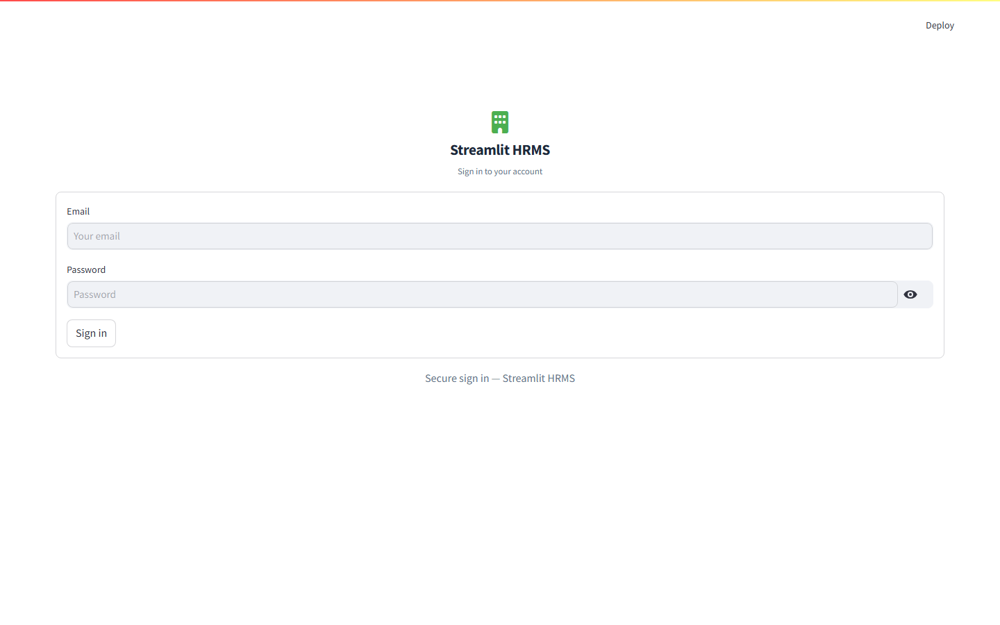
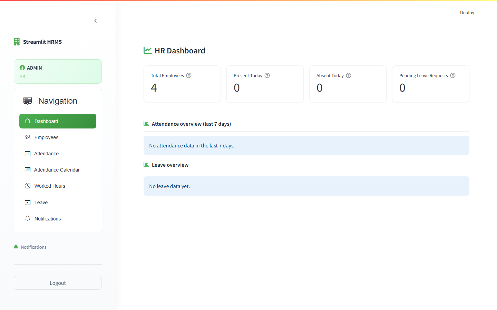
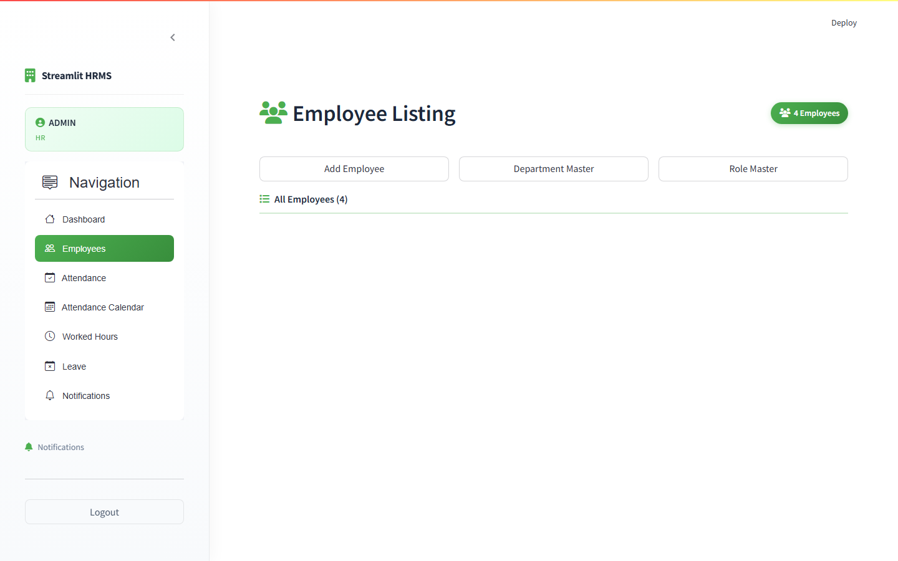
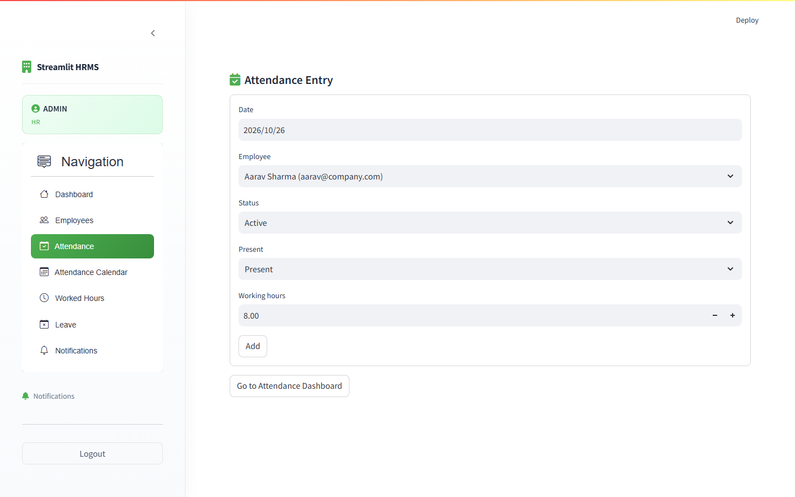
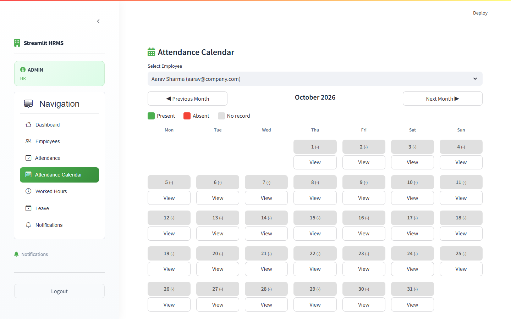
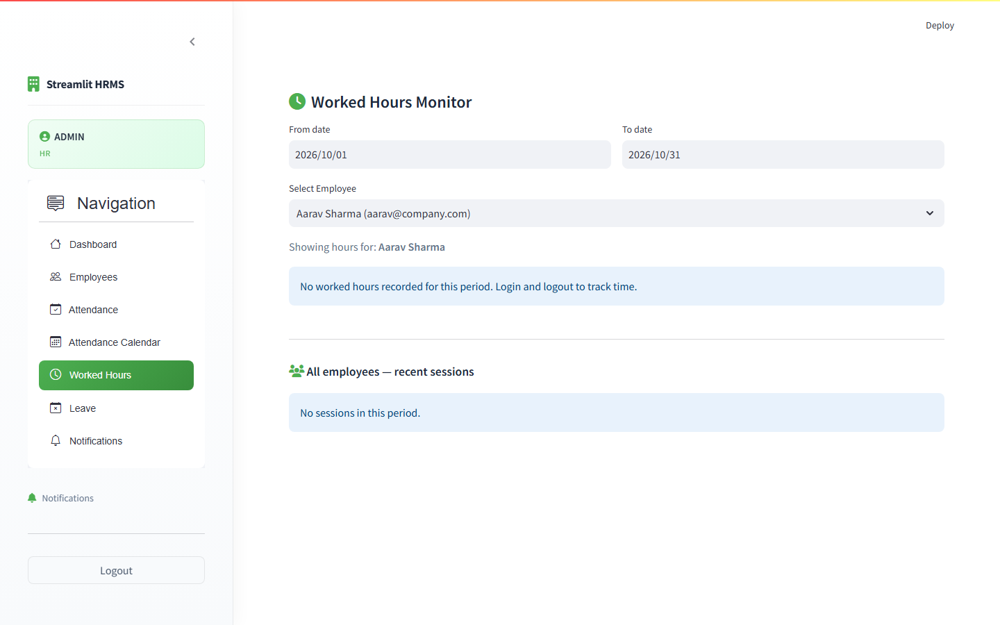
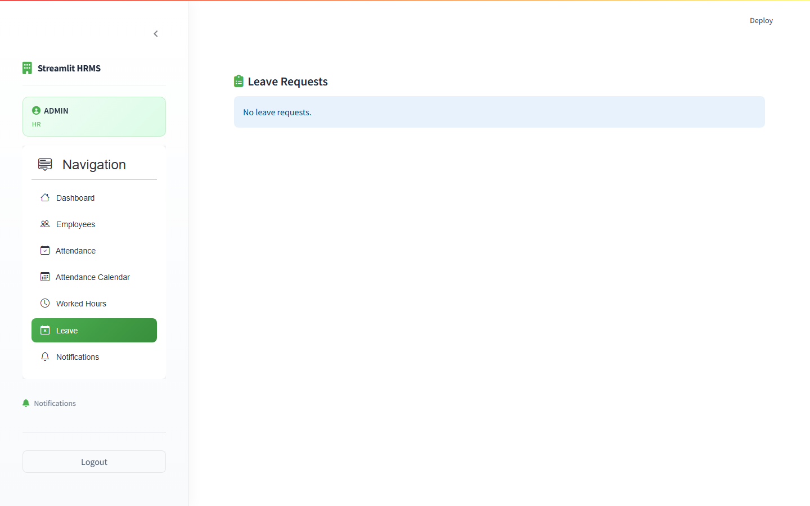

# 🏢 Streamlit HRMS (Human Resource Management System)

A professional, full-featured Human Resource Management web application built with **Streamlit**, **Python**, **SQLite**, and **SQLAlchemy ORM**.

---

## 📸 HR Manager Page Previews

### 1. Secure Authentication & Login


### 2. HR Analytics Dashboard
Overview metrics cards, department distributions, attendance breakdown, and leave summary.


### 3. Employee Management
Complete employee directory with AGGrid data table, department & role assignments, and add/edit/delete actions.


### 4. Attendance Management & Daily Logs
Employee attendance logging, present/absent/WFH tracking, and working hours entry.


### 5. Monthly Attendance Calendar
Interactive calendar visualization showing daily attendance status and working hours per employee.


### 6. Worked Hours & Analytics
Detailed working hours summary, overtime tracking, and productivity reports.


### 7. Leave Management & Approvals
Leave requests review, auto total-day calculation, approval/rejection workflows, and HR comments.


### 8. Notifications Center
System notifications, leave request alerts, and instant unread count badge.


---

## ✨ Features

- **Role-Based Access Control**: Separate secure portals for HR Managers and Employees.
- **HR First-Time Setup**: Automated registration wizard when no HR account exists.
- **Interactive Dashboard**: Metrics cards, real-time charts (Plotly), and status overviews.
- **Employee Directory**: Rich interactive data grid (Streamlit-AGGrid) with search, filter, and sorting.
- **Department & Role Masters**: Dynamic organizational structure management.
- **Attendance & Time Tracking**: Daily clock-in logs, WFH detection, and monthly calendar views.
- **Leave Workflow**: Employee leave requests with auto working-day computation and HR approval/rejection.
- **Instant Notifications**: Notification bells with unread counters and status indicators.

---

## 🚀 Setup & Installation

### 1. Clone or Navigate to the Project
```bash
cd hrms_streamlit
```

### 2. Set Up Virtual Environment (Recommended)
```bash
# Windows
python -m venv venv
venv\Scripts\activate

# macOS / Linux
python3 -m venv venv
source venv/bin/activate
```

### 3. Install Dependencies
```bash
pip install -r requirements.txt
```

### 4. Run the Streamlit Application
```bash
streamlit run app.py
```

The application will launch automatically in your browser at `http://localhost:8501`.

---

## 📁 Project Structure

```text
hrms_streamlit/
├── app.py                 # Main entry point, sidebar navigation & theming
├── database/
│   ├── db.py              # SQLAlchemy engine, session management & migrations
│   └── db_models.py       # ORM schemas (HR, Employee, Department, Role, Attendance, Leave, etc.)
├── models/
│   ├── hr.py              # HR queries & authentication logic
│   ├── employee.py        # Employee CRUD operations
│   ├── attendance.py      # Attendance records queries
│   ├── leave.py           # Leave workflow functions
│   └── notification.py    # Notification helpers
├── views/
│   ├── login.py           # Login card & registration view
│   ├── dashboard.py       # Metrics & analytics charts
│   ├── employee_module.py # AGGrid employee management table
│   ├── attendance_module.py # Daily attendance entries
│   ├── attendance_calendar.py # Monthly attendance grid
│   ├── worked_hours.py    # Hours analysis & reporting
│   ├── leave_module.py    # Leave review & approval portal
│   └── notification.py    # Notification list
├── assets/
│   └── style.css          # Custom styling & modern card theme
├── screenshots/           # HR Manager page screenshots
├── requirements.txt       # Project dependencies
└── README.md              # Documentation
```

---

## ⚙️ Configuration & Defaults

- **Database**: `hrms.db` (SQLite) located in project root
- **Security**: Passwords securely hashed with SHA-256 before storage
- **UI Theme**: Professional Emerald & Blue palette (`#4CAF50` / `#2196F3`)
